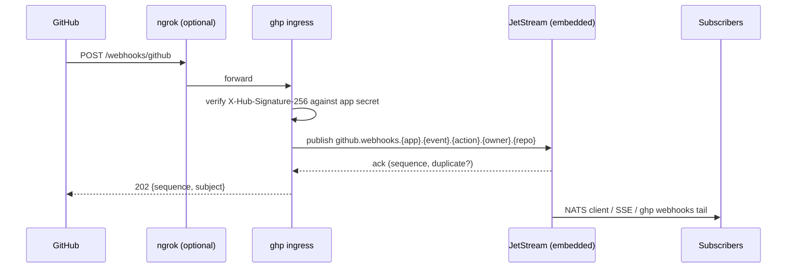

# Webhooks

ghp can be the single receiving point for GitHub webhooks across every GitHub
App it manages. Deliveries are verified, stored durably in an embedded
[NATS JetStream](https://docs.nats.io/nats-concepts/jetstream) stream, and
fanned out to any number of subscribers: native NATS clients, the admin
server-sent-events stream, or the `ghp webhooks tail` CLI. An optional embedded
[ngrok](https://ngrok.com) tunnel gives an instance behind NAT a public HTTPS
endpoint without any extra infrastructure.

Both embedded services are off by default. ghp stays a single static binary.

## Why

Agents working through ghp can read GitHub state but have no way to *react*
to it (a review comment, a failed check, a new issue) other than polling.
Every registered app already has its credentials in ghp; receiving its
webhooks in the same place closes the loop and gives every subscriber a
replayable, filterable event log instead of a one-shot HTTP callback.

## How it works



1. GitHub posts a delivery to the ingress path (default `/webhooks/github`)
   on the management host, or on the ngrok endpoint when the tunnel is
   enabled. Nothing else is reachable through the tunnel.
2. ghp resolves the candidate secrets for the delivery and verifies
   `X-Hub-Signature-256` (HMAC-SHA256 over the raw body). A delivery that does
   not verify is rejected with `401` and never stored.
3. The payload is published to the JetStream stream with the delivery GUID as
   the message ID, so GitHub redeliveries inside the dedupe window are
   reported as duplicates instead of stored twice.
4. ghp answers `202 Accepted` with the stream sequence and subject (visible in
   GitHub's delivery log), or `503` if the publish failed so the operator can
   redeliver from GitHub.

### Secret resolution

Each app record carries its own webhook secret (set it in the admin UI's app
form or via `webhook_secret` on `POST`/`PUT /api/apps`). It is encrypted at
rest like the client secret and never returned by the API. Candidates are
tried in this order and the first match wins:

1. The app whose GitHub App ID equals `X-GitHub-Hook-Installation-Target-ID`,
   when `X-GitHub-Hook-Installation-Target-Type` is `integration` (that is,
   the delivery comes from a GitHub App's webhook) and that app has a secret.
2. The server-wide `webhooks.secret`, when configured.
3. For deliveries that do not come from an app (repository, organisation or
   enterprise hooks), every app that has a secret. This lets an operator
   reuse an app's secret for a repository hook without a second secret.

A delivery addressed to one app is never accepted under another app's
secret. A delivery whose target has no secret at all is rejected with
`401` ("unknown_app" in metrics).

### Supported formats

Every event type GitHub sends is accepted, including `ping` and the
app/installation lifecycle events. Both `application/json` and
`application/x-www-form-urlencoded` content types are supported; form
deliveries are verified over the raw form body and then unwrapped to the JSON
in the `payload` parameter, so subscribers always receive JSON. Bodies up to
`webhooks.max_payload_bytes` (default 25 MiB, GitHub's maximum) are accepted.

### Subjects

Deliveries are published under

    {subject_prefix}.{app_record_id}.{event}.{action}.{owner}.{repo}

Every token is sanitised to `[A-Za-z0-9_-]` (a `.` in a repository name
becomes `_`) and missing values become `_`, so a subject always has exactly
six tokens after the prefix. Examples with the default prefix:

| Delivery | Subject |
|---|---|
| `pull_request` / `opened` on `goodtune/ghp` from app `3f1c…` | `github.webhooks.3f1c….pull_request.opened.goodtune.ghp` |
| `push` on `goodtune/ghp` | `github.webhooks.3f1c….push._.goodtune.ghp` |
| `ping` for a repository hook verified by the global secret | `github.webhooks._.ping._._._` |

Useful filters:

| Filter | Matches |
|---|---|
| `github.webhooks.>` | everything |
| `github.webhooks.*.pull_request.>` | every pull request event, any app |
| `github.webhooks.*.*.*.myorg.>` | everything for repositories owned by `myorg` |
| `github.webhooks.<app-record-id>.>` | everything received for one app |
| `github.webhooks.*.issues.opened.>` | newly opened issues |

### Message headers

Each stored message carries headers subscribers can use without parsing the
payload:

| Header | Value |
|---|---|
| `GitHub-Delivery`, `GitHub-Event`, `GitHub-Hook-ID`, `GitHub-Hook-Installation-Target-Type`, `GitHub-Hook-Installation-Target-ID` | copied from the inbound request |
| `GHP-App-Record-ID`, `GHP-App-Name` | the app whose secret verified the delivery (absent for the global secret) |
| `GHP-Action`, `GHP-Repository` (`owner/repo`), `GHP-Installation-ID`, `GHP-Sender` | extracted from the payload when present |
| `GHP-Received-At` | RFC 3339 timestamp of receipt |
| `Content-Type` / `GHP-Original-Content-Type` | always `application/json` / the inbound content type |
| `Hub-Signature-256`, `Hub-Signature` | GitHub's original `X-Hub-Signature-256` and (when sent) `X-Hub-Signature` values |
| `GHP-Original-User-Agent` | GitHub's original `User-Agent` |
| `Nats-Msg-Id` | the delivery GUID (JetStream deduplication key) |

## Configuration

```yaml
server:
  base_url: https://ghp.example.com   # used for the ingress URL when ngrok is off

webhooks:
  enabled: true
  path: /webhooks/github
  nats:
    store_dir: /var/lib/ghp/nats
    max_age: 168h
    max_bytes: 1073741824
  ngrok:
    enabled: true
    domain: hooks.example.ngrok.app   # reserved domain; omit for a random URL
```

See the [configuration reference](../admin/configuration.md#webhooks) for every
field and its environment variable. The section is bound at startup: changing
it requires a restart.

### Registering the webhook on GitHub

1. Set the app's webhook secret in ghp (admin UI → Apps → Add/Edit App →
   *Webhook Secret*), or `PUT /api/apps/{id}` with `{"webhook_secret": "..."}`.
2. Read the ingress URL from the Webhooks panel on the admin page, from
   `ghp webhooks status`, or from `GET /api/webhooks/status`. With ngrok it
   is the tunnel URL plus the path; otherwise it is `server.base_url` plus the
   path.
3. In the GitHub App settings set **Webhook URL** to that URL, **Webhook
   secret** to the same secret, content type to either option, and
   subscribe to the events you need.
4. GitHub sends a `ping`; it appears in the recent deliveries list with its
   sequence number, and GitHub's delivery log shows ghp's `202` response.

Without a reserved domain ngrok assigns a new URL on every start, so the
GitHub App settings must be updated after each restart. A reserved domain
(free tier includes one) avoids that.

## Subscribing

### Admin SSE stream

`GET /api/webhooks/stream` (admin session) emits one server-sent event per
delivery:

```
id: 42
event: pull_request
data: {"subject":"github.webhooks.3f1c….pull_request.opened.goodtune.ghp","sequence":42,"delivery":"…","event":"pull_request","action":"opened","app_record_id":"3f1c…","app_name":"Review Bot","repository":"goodtune/ghp","installation_id":424242,"sender":"octocat","received_at":"…","stored_at":"…","headers":{…},"payload":{…}}
```

| Query parameter | Meaning |
|---|---|
| `filter` | subject filter under the prefix, e.g. `github.webhooks.*.push.>` (default: everything) |
| `from` | `new` (default), `all`, or a stream sequence number |
| `durable` | name of a server-side consumer that remembers its position; events are acknowledged only after they are flushed to the client |
| `raw` | `1` replaces `payload` with `payload_base64`: the exact stored message bytes, base64-encoded. For JSON deliveries these are the bytes GitHub signed (`payload` is re-encoded JSON and is not byte-faithful). `payload_base64` is omitted for an empty body |
| `ack` | `client` (requires `durable`) holds each delivery until the client acknowledges it; see below. `server` (default) acknowledges on flush, so an event written to a connection that is closing can be lost (see [Limitations](#limitations)) |

Reconnecting with the standard `Last-Event-ID` header resumes after that
sequence. A `: ping` comment is sent every 15 seconds while idle.

Durable names are sanitised to `[A-Za-z0-9_-]` (so `review agent` and
`review_agent` are the same consumer) and `from`/`Last-Event-ID` only apply
when the consumer is first created: afterwards the consumer's own
acknowledged position is authoritative, which is what makes a restarted
subscriber resume correctly.

The envelope also carries `signature_256`, `signature_sha1`, `user_agent` and
`original_content_type`: GitHub's original `X-Hub-Signature-256`,
`X-Hub-Signature`, `User-Agent` and `Content-Type`. They are empty for
deliveries stored before ghp kept them.

#### Client acknowledgement (`ack=client`)

With `ack=client&durable=NAME` the stream first sends a session event:

```
event: session
data: {"session":"<64 hex characters>"}
```

Each delivery is then held unacknowledged until the client confirms it:

```
POST /api/webhooks/stream/ack      (admin session)
{"session": "<token>", "sequence": 42}
```

The server does not fetch the next delivery until the pending one is
acknowledged. While it waits it sends `InProgress` to JetStream every third
of the 10-second ack timeout, so a slow client does not cause a redelivery.
When the stream ends with a delivery still pending (client disconnect or
server shutdown) the server Naks it, and the durable consumer redelivers it
at once. If ghp itself dies, JetStream redelivers after the ack timeout.
Events are written in 64 KiB chunks, and the 10-second write deadline is
reset before each chunk. A slow client that keeps reading receives an event
of any size; a client that stops reading for 10 seconds is cut off, and its
pending delivery is Nak'd. This applies to every stream mode.

The stream response carries the header `GHP-Webhook-Client-Ack: 1`. A
client must check it before it reads events: an older server ignores
`ack=client` and acknowledges each delivery as soon as it sends it.

Only one client-ack stream may consume a durable at a time. A new
`ack=client` stream on the same durable ends the older one. The older
stream Naks its pending delivery, sends an evicted event and closes, and
the new stream subscribes only after that, so it receives the held
delivery first and order is kept:

```
event: evicted
data: {"reason":"another client-ack stream took over this durable","durable":"<name>","by":"<github login>"}
```

`by` is the GitHub login of the admin who opened the new stream. If the
older stream was cut in the middle of a large event, the server first ends
that partial event with a blank line, so the client discards it and still
reads the evicted event. A stream that is itself replaced while it is still
opening (before its session event) receives only the evicted event. The new stream waits at most 25 seconds
(twice the chunk write deadline, plus 5 seconds) for the older one to let
go; if the older stream has not released by then, the new stream
subscribes anyway and order is not guaranteed. A plain
(`ack=server`) stream or a native NATS client on the same durable is not
detected; do not share a client-ack durable with them, because they would
take deliveries the client-ack stream then never sees.

The session token is random, bound to the stream connection and to the
admin user who opened it, and ends with the stream. Every response from
the ack endpoint carries the header `GHP-Webhook-Client-Ack: 1`, so a
client can tell it from a 400 or 404 produced by an older server or a
proxy. Responses:

| Status | Meaning |
|---|---|
| 200 | acknowledged; JetStream confirmed the ack |
| 400 | malformed body, session not 64 hex characters, or `sequence` not positive |
| 404 | no open stream of the caller has that session |
| 409 | the session's pending delivery is not that sequence. The body `code` says why: `acked` (that sequence was already acknowledged; only the answer was lost), `released` (the server returned it to the durable, for example after an `ack_error`, and redelivers it), or `wrong_sequence` |
| 413 | body larger than 4 KiB |
| 502 | the JetStream ack failed (body `"code": "ack_error"`); the server has released the stream and redelivers the delivery after the ack timeout, so the client must not retry |

`GET /api/webhooks/status` reports the ingest body cap as
`max_payload_bytes`; `ghp webhooks tail --relay` sizes its stream reader
from it.

`GET /api/webhooks/deliveries?limit=N` lists the most recent deliveries
(newest first, without payloads; default 50, maximum 200) and
`GET /api/webhooks/deliveries/{seq}` returns one delivery with its payload.
The `apps` list in `GET /api/webhooks/status` names the GitHub App ID
`github_app_id`; the older `/api/apps` responses call the same number
`app_id`.

### CLI

    ghp webhooks status
    ghp webhooks tail --filter 'github.webhooks.*.pull_request.>'
    ghp webhooks tail --from all --json | jq .payload.pull_request.title
    ghp webhooks tail --durable review-agent --payload
    ghp webhooks tail --durable skipper --relay http://127.0.0.1:3000/github/webhook

See [ghp webhooks](../cli/webhooks.md).

### Relaying to a local receiver

`ghp webhooks tail --relay URL --durable NAME` turns ghp into a forwarder
for an application that already has a GitHub webhook receiver. Each
delivery is POSTed to `URL` with the exact body GitHub signed and GitHub's
original headers, so a receiver that verifies `X-Hub-Signature-256` with the
GitHub App's webhook secret cannot tell it from a direct delivery. The relay
uses client acknowledgement (`ack=client`) and the raw payload (`raw=1`): a
delivery is acknowledged only after the receiver answers 2xx, and is retried
with backoff until then. See [ghp webhooks](../cli/webhooks.md#relaying-to-a-receiver).

The signature is GitHub's, made with the secret GitHub used. Configure the
receiver with the same secret as the GitHub App (or as the server-wide
`webhooks.secret`, for deliveries verified by it).

### Native NATS clients

Set `webhooks.nats.listen` and `webhooks.nats.auth_token` to let NATS clients
connect directly and use the full JetStream feature set (durable pull
consumers, batching, work queues shared by several workers). Clients
authenticate as user `subscriber` with the token as password:

```go
nc, _ := nats.Connect("nats://ghp.internal:4222", nats.UserInfo("subscriber", os.Getenv("GHP_NATS_TOKEN")))
js, _ := jetstream.New(nc)
cons, _ := js.CreateOrUpdateConsumer(ctx, "GITHUB_WEBHOOKS", jetstream.ConsumerConfig{
    Durable:        "review-agent",
    FilterSubjects: []string{"github.webhooks.*.pull_request.>"},
    AckPolicy:      jetstream.AckExplicitPolicy,
})
cons.Consume(func(m jetstream.Msg) {
    fmt.Println(m.Headers().Get("GHP-Repository"), string(m.Data()))
    m.Ack()
})
```

The listener uses the `tls.certificates` when `webhooks.nats.tls` is true.
The `subscriber` user can read the whole stream and create, update or delete
consumers, but cannot publish into the webhook subject space or create,
alter, purge or delete the stream: a leaked token cannot forge deliveries or
destroy the log. ghp's own in-process connection uses a separate random
per-process credential. There is no per-subject read authorisation, so bind
the listener to a private interface.

## Admin UI

The admin page shows a **Webhooks** panel when the feature is enabled: the
ingress URL with a copy button, ngrok and NATS listener state, stream size
and retention, how many apps have a secret, and the most recent deliveries
with a button that loads the full payload. The Apps table has a **Webhook**
column showing whether each app has a secret, and the add/edit forms take the
secret (the edit form can also remove it).

## Metrics

| Metric | Labels | Meaning |
|---|---|---|
| `ghp_webhook_received_total` | `event`, `result` | deliveries by outcome: `published`, `duplicate`, `invalid_signature`, `unknown_app`, `bad_request`, `publish_error`, `internal_error` |
| `ghp_webhook_publish_duration_seconds` | — | JetStream publish + ack latency |
| `ghp_webhook_ngrok_tunnel_up` | — | 1 while the ngrok session is connected |
| `ghp_webhook_stream_messages`, `ghp_webhook_stream_bytes` | — | current stream size (refreshed every 30 s) |
| `ghp_webhook_subscribers_active` | `kind` | open SSE streams (`sse`) and native NATS clients (`nats`) |
| `ghp_webhook_stream_ack_total` | `result` | client-ack stream outcomes: `acked`, `ack_error`, `wrong_sequence`, `invalid_session`, `bad_request`, `nak_disconnect`, `nak_shutdown`, `nak_evicted` |

The `event` label is bounded by GitHub's event catalogue; unrecognised names
are reported as `unknown` (the real name is still stored on the message).

## Limitations

- **SHA-256 only.** GitHub's legacy `X-Hub-Signature` (SHA-1) header is
  never verified; a delivery carrying only that header is rejected. Its
  value is stored, unverified, only so that `--relay` can pass it on.
- **Single instance.** The JetStream store is local to one ghp process.
  In HA deployments point GitHub (or ngrok) at one instance; the admin API
  on other instances reports the feature as enabled but reads their own
  (empty) streams.
- **No rate limiting on the ingress.** The ingress is unauthenticated by
  nature (GitHub signs rather than logs in); each request costs at most one
  body read (capped by `max_payload_bytes`) and one HMAC per candidate
  secret. Put it behind your usual edge protection if that matters.
- **Subscribing is an admin capability.** Scoping webhook visibility to the
  repositories of a `ghx_`/`gha_` token is future work; today the SSE stream
  and CLI require an admin session.
- **ngrok reconnects, but the URL may change.** Without a reserved domain the
  public URL changes on every restart. If ngrok is unreachable at startup
  the server still starts; the tunnel is retried with backoff and the
  ingress remains available on the management host.
- **At-least-once for durable consumers.** A subscriber that disconnects
  after a delivery was sent but before it was acknowledged sees that
  delivery again on reconnect. Use the delivery GUID to deduplicate.
  A delivery that the server receives from JetStream just as the client
  goes away is returned to the stream at once, so the reconnecting client
  gets it without waiting for the 10-second ack timeout. The server checks
  for a disconnect at least once a second, so a durable stream ends within
  about one second of the client going away.
- **SSE acknowledges on flush unless `ack=client`.** By default the server
  acknowledges a delivery when the bytes are flushed to the connection, not
  when the client reads them. The server detects a closed connection
  asynchronously; an event written in that short window can land in the
  dead connection's buffers, be acknowledged, and not be replayed on
  reconnect. Clients that need every event should use `ack=client` (as
  `ghp webhooks tail --relay` does) or connect to NATS directly and
  acknowledge each message themselves.
- **Relay replays only what can verify.** Deliveries stored before ghp kept
  the original signature headers have no signature to send; the relay skips
  them with a warning and acknowledges them so the stream does not wedge.
  Form-encoded deliveries (`application/x-www-form-urlencoded`) are stored
  as the unwrapped JSON payload, not the signed form body, and the original
  form encoding cannot be rebuilt byte for byte, so they are skipped the
  same way. GitHub App webhooks are always JSON.
- **A rejecting relay target stalls the relay.** Nothing is skipped on a
  non-2xx answer: the relay retries the same delivery until the target
  accepts it or the command is interrupted, and later deliveries wait.
  Delivery to the target is at-least-once; a receiver should deduplicate on
  `X-GitHub-Delivery`.
- **A relay durable must not be shared.** Run one relay per durable name,
  and do not use the same name for a plain `ghp webhooks tail --durable` or
  a native NATS consumer. A second relay on the name takes over: the first
  relay receives `event: evicted` and stops with "durable NAME was taken
  over by another relay (opened by LOGIN)". A delivery the first relay was
  posting at that moment can reach the target twice. Under a supervisor
  that restarts relays (for example systemd `Restart=always`), two relays
  on one durable alternate at the restart interval. A plain consumer would
  take deliveries away from the relay.
- **Any admin can take over a relay durable.** Durable names are shared
  by all admins, not kept per user. An admin who opens a client-ack stream
  (for example a relay) with another admin's durable name takes it over;
  the evicted relay stops and prints that admin's GitHub login (`by` in the
  evicted event). Give each relay a distinct name.
- **The relay posts to any host its operator names.** `--relay` accepts any
  `http` or `https` URL, including loopback and private addresses. ghp does
  not restrict the target: the relay runs on the machine where the command
  runs, with the rights of whoever runs it, so loopback means that machine.
  It sends the delivery body and GitHub's headers, never the ghp session
  token, and it redacts the URL's query string in its output.
- **Relay delivery is bounded by stream retention.** `webhooks.nats.max_age`
  and `webhooks.nats.max_bytes` discard the oldest deliveries even when a
  stalled or stopped relay has not relayed them. A durable with no
  subscriber for 7 days is deleted; a relay started later with the same
  name recreates it at its `--from` position (default `new`) and skips the
  backlog without a warning. Size retention for the longest outage you must
  survive, alert on stalled relays, and restart an expired relay with
  `--from SEQ` or `--from all` (see [the CLI page](../cli/webhooks.md)).
