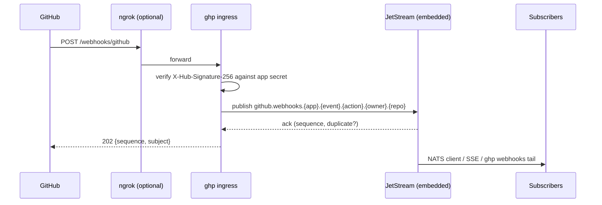

# Webhooks

ghp can be the single receiving point for GitHub webhooks across every GitHub
App it manages. Deliveries are verified, stored durably in an embedded
[NATS JetStream](https://docs.nats.io/nats-concepts/jetstream) stream, and
fanned out to any number of subscribers: native NATS clients, the admin
server-sent-events stream, or the `ghp webhooks tail` CLI. An optional embedded
[ngrok](https://ngrok.com) tunnel gives an instance behind NAT a public HTTPS
endpoint without any extra infrastructure.

Both embedded services are off by default. ghp stays a single static binary.

## Why

Agents working through ghp can read GitHub state but have no way to *react*
to it (a review comment, a failed check, a new issue) other than polling.
Every registered app already has its credentials in ghp; receiving its
webhooks in the same place closes the loop and gives every subscriber a
replayable, filterable event log instead of a one-shot HTTP callback.

## How it works



1. GitHub posts a delivery to the ingress path (default `/webhooks/github`)
   on the management host, or on the ngrok endpoint when the tunnel is
   enabled. Nothing else is reachable through the tunnel.
2. ghp resolves the candidate secrets for the delivery and verifies
   `X-Hub-Signature-256` (HMAC-SHA256 over the raw body). A delivery that does
   not verify is rejected with `401` and never stored.
3. The payload is published to the JetStream stream with the delivery GUID as
   the message ID, so GitHub redeliveries inside the dedupe window are
   reported as duplicates instead of stored twice.
4. ghp answers `202 Accepted` with the stream sequence and subject (visible in
   GitHub's delivery log), or `503` if the publish failed so the operator can
   redeliver from GitHub.

### Secret resolution

Each app record carries its own webhook secret (set it in the admin UI's app
form or via `webhook_secret` on `POST`/`PUT /api/apps`). It is encrypted at
rest like the client secret and never returned by the API. Candidates are
tried in this order and the first match wins:

1. The app whose GitHub App ID equals `X-GitHub-Hook-Installation-Target-ID`,
   when `X-GitHub-Hook-Installation-Target-Type` is `integration` (that is,
   the delivery comes from a GitHub App's webhook) and that app has a secret.
2. The server-wide `webhooks.secret`, when configured.
3. For deliveries that do not come from an app (repository, organisation or
   enterprise hooks), every app that has a secret. This lets an operator
   reuse an app's secret for a repository hook without a second secret.

A delivery addressed to one app is never accepted under another app's
secret. A delivery whose target has no secret at all is rejected with
`401` ("unknown_app" in metrics).

### Supported formats

Every event type GitHub sends is accepted, including `ping` and the
app/installation lifecycle events. Both `application/json` and
`application/x-www-form-urlencoded` content types are supported; form
deliveries are verified over the raw form body and then unwrapped to the JSON
in the `payload` parameter, so subscribers always receive JSON. Bodies up to
`webhooks.max_payload_bytes` (default 25 MiB, GitHub's maximum) are accepted.

### Subjects

Deliveries are published under

    {subject_prefix}.{app_record_id}.{event}.{action}.{owner}.{repo}

Every token is sanitised to `[A-Za-z0-9_-]` (a `.` in a repository name
becomes `_`) and missing values become `_`, so a subject always has exactly
six tokens after the prefix. Examples with the default prefix:

| Delivery | Subject |
|---|---|
| `pull_request` / `opened` on `goodtune/ghp` from app `3f1c…` | `github.webhooks.3f1c….pull_request.opened.goodtune.ghp` |
| `push` on `goodtune/ghp` | `github.webhooks.3f1c….push._.goodtune.ghp` |
| `ping` for a repository hook verified by the global secret | `github.webhooks._.ping._._._` |

Useful filters:

| Filter | Matches |
|---|---|
| `github.webhooks.>` | everything |
| `github.webhooks.*.pull_request.>` | every pull request event, any app |
| `github.webhooks.*.*.*.myorg.>` | everything for repositories owned by `myorg` |
| `github.webhooks.<app-record-id>.>` | everything received for one app |
| `github.webhooks.*.issues.opened.>` | newly opened issues |

### Message headers

Each stored message carries headers subscribers can use without parsing the
payload:

| Header | Value |
|---|---|
| `GitHub-Delivery`, `GitHub-Event`, `GitHub-Hook-ID`, `GitHub-Hook-Installation-Target-Type`, `GitHub-Hook-Installation-Target-ID` | copied from the inbound request |
| `GHP-App-Record-ID`, `GHP-App-Name` | the app whose secret verified the delivery (absent for the global secret) |
| `GHP-Action`, `GHP-Repository` (`owner/repo`), `GHP-Installation-ID`, `GHP-Sender` | extracted from the payload when present |
| `GHP-Received-At` | RFC 3339 timestamp of receipt |
| `Content-Type` / `GHP-Original-Content-Type` | always `application/json` / the inbound content type |
| `Nats-Msg-Id` | the delivery GUID (JetStream deduplication key) |

## Configuration

```yaml
server:
  base_url: https://ghp.example.com   # used for the ingress URL when ngrok is off

webhooks:
  enabled: true
  path: /webhooks/github
  nats:
    store_dir: /var/lib/ghp/nats
    max_age: 168h
    max_bytes: 1073741824
  ngrok:
    enabled: true
    domain: hooks.example.ngrok.app   # reserved domain; omit for a random URL
```

See the [configuration reference](../admin/configuration.md#webhooks) for every
field and its environment variable. The section is bound at startup: changing
it requires a restart.

### Registering the webhook on GitHub

1. Set the app's webhook secret in ghp (admin UI → Apps → Add/Edit App →
   *Webhook Secret*), or `PUT /api/apps/{id}` with `{"webhook_secret": "..."}`.
2. Read the ingress URL from the Webhooks panel on the admin page, from
   `ghp webhooks status`, or from `GET /api/webhooks/status`. With ngrok it
   is the tunnel URL plus the path; otherwise it is `server.base_url` plus the
   path.
3. In the GitHub App settings set **Webhook URL** to that URL, **Webhook
   secret** to the same secret, content type to either option, and
   subscribe to the events you need.
4. GitHub sends a `ping`; it appears in the recent deliveries list with its
   sequence number, and GitHub's delivery log shows ghp's `202` response.

Without a reserved domain ngrok assigns a new URL on every start, so the
GitHub App settings must be updated after each restart. A reserved domain
(free tier includes one) avoids that.

## Subscribing

### Admin SSE stream

`GET /api/webhooks/stream` (admin session) emits one server-sent event per
delivery:

```
id: 42
event: pull_request
data: {"subject":"github.webhooks.3f1c….pull_request.opened.goodtune.ghp","sequence":42,"delivery":"…","event":"pull_request","action":"opened","app_record_id":"3f1c…","app_name":"Review Bot","repository":"goodtune/ghp","installation_id":424242,"sender":"octocat","received_at":"…","stored_at":"…","headers":{…},"payload":{…}}
```

| Query parameter | Meaning |
|---|---|
| `filter` | subject filter under the prefix, e.g. `github.webhooks.*.push.>` (default: everything) |
| `from` | `new` (default), `all`, or a stream sequence number |
| `durable` | name of a server-side consumer that remembers its position; events are acknowledged only after they are flushed to the client |

Reconnecting with the standard `Last-Event-ID` header resumes after that
sequence. A `: ping` comment is sent every 15 seconds while idle.

Durable names are sanitised to `[A-Za-z0-9_-]` (so `review agent` and
`review_agent` are the same consumer) and `from`/`Last-Event-ID` only apply
when the consumer is first created: afterwards the consumer's own
acknowledged position is authoritative, which is what makes a restarted
subscriber resume correctly.

`GET /api/webhooks/deliveries?limit=N` lists the most recent deliveries
(newest first, without payloads; default 50, maximum 200) and
`GET /api/webhooks/deliveries/{seq}` returns one delivery with its payload.
The `apps` list in `GET /api/webhooks/status` names the GitHub App ID
`github_app_id`; the older `/api/apps` responses call the same number
`app_id`.

### CLI

    ghp webhooks status
    ghp webhooks tail --filter 'github.webhooks.*.pull_request.>'
    ghp webhooks tail --from all --json | jq .payload.pull_request.title
    ghp webhooks tail --durable review-agent --payload

See [ghp webhooks](../cli/webhooks.md).

### Native NATS clients

Set `webhooks.nats.listen` and `webhooks.nats.auth_token` to let NATS clients
connect directly and use the full JetStream feature set (durable pull
consumers, batching, work queues shared by several workers). Clients
authenticate as user `subscriber` with the token as password:

```go
nc, _ := nats.Connect("nats://ghp.internal:4222", nats.UserInfo("subscriber", os.Getenv("GHP_NATS_TOKEN")))
js, _ := jetstream.New(nc)
cons, _ := js.CreateOrUpdateConsumer(ctx, "GITHUB_WEBHOOKS", jetstream.ConsumerConfig{
    Durable:        "review-agent",
    FilterSubjects: []string{"github.webhooks.*.pull_request.>"},
    AckPolicy:      jetstream.AckExplicitPolicy,
})
cons.Consume(func(m jetstream.Msg) {
    fmt.Println(m.Headers().Get("GHP-Repository"), string(m.Data()))
    m.Ack()
})
```

The listener uses the `tls.certificates` when `webhooks.nats.tls` is true.
The `subscriber` user can read the whole stream and create, update or delete
consumers, but cannot publish into the webhook subject space or create,
alter, purge or delete the stream: a leaked token cannot forge deliveries or
destroy the log. ghp's own in-process connection uses a separate random
per-process credential. There is no per-subject read authorisation, so bind
the listener to a private interface.

## Admin UI

The admin page shows a **Webhooks** panel when the feature is enabled: the
ingress URL with a copy button, ngrok and NATS listener state, stream size
and retention, how many apps have a secret, and the most recent deliveries
with a button that loads the full payload. The Apps table has a **Webhook**
column showing whether each app has a secret, and the add/edit forms take the
secret (the edit form can also remove it).

## Metrics

| Metric | Labels | Meaning |
|---|---|---|
| `ghp_webhook_received_total` | `event`, `result` | deliveries by outcome: `published`, `duplicate`, `invalid_signature`, `unknown_app`, `bad_request`, `publish_error`, `internal_error` |
| `ghp_webhook_publish_duration_seconds` | — | JetStream publish + ack latency |
| `ghp_webhook_ngrok_tunnel_up` | — | 1 while the ngrok session is connected |
| `ghp_webhook_stream_messages`, `ghp_webhook_stream_bytes` | — | current stream size (refreshed every 30 s) |
| `ghp_webhook_subscribers_active` | `kind` | open SSE streams (`sse`) and native NATS clients (`nats`) |

The `event` label is bounded by GitHub's event catalogue; unrecognised names
are reported as `unknown` (the real name is still stored on the message).

## Limitations

- **SHA-256 only.** GitHub's legacy `X-Hub-Signature` (SHA-1) header is
  ignored; a delivery carrying only that header is rejected.
- **Single instance.** The JetStream store is local to one ghp process.
  In HA deployments point GitHub (or ngrok) at one instance; the admin API
  on other instances reports the feature as enabled but reads their own
  (empty) streams.
- **No rate limiting on the ingress.** The ingress is unauthenticated by
  nature (GitHub signs rather than logs in); each request costs at most one
  body read (capped by `max_payload_bytes`) and one HMAC per candidate
  secret. Put it behind your usual edge protection if that matters.
- **Subscribing is an admin capability.** Scoping webhook visibility to the
  repositories of a `ghx_`/`gha_` token is future work; today the SSE stream
  and CLI require an admin session.
- **ngrok reconnects, but the URL may change.** Without a reserved domain the
  public URL changes on every restart. If ngrok is unreachable at startup
  the server still starts; the tunnel is retried with backoff and the
  ingress remains available on the management host.
- **At-least-once for durable consumers.** A subscriber that disconnects
  after a delivery was sent but before it was acknowledged sees that
  delivery again on reconnect. Use the delivery GUID to deduplicate.
